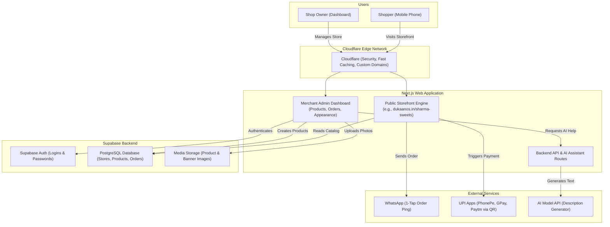

# DukaanOS — Technology Decisions & Architectural Blueprint

**Version:** 1.0  
**Status:** Proposed Architecture  
**Audience:** Non-Technical Founder & Engineering Team

---

## 1. The Technology Stack at a Glance

We have intentionally selected an industry-standard, battle-tested modern web stack. Every tool has been chosen to maximize reliability, maintain fast loading speeds on Indian mobile networks, and keep monthly server costs near zero during our launch and early-growth phases.

| Technology | What it is in Simple English | Real-World Analogy | Why it's the Best Choice for DukaanOS |
| :--- | :--- | :--- | :--- |
| **Next.js** | The core website engine and web framework. | **The Car Chassis & Engine:** It drives everything, powers the dashboard, and delivers the storefronts to customers. | Combines the customer-facing storefronts and the merchant dashboard in one clean codebase. Extremely fast page loads and built-in search engine optimization (SEO) so Google can find every shop. |
| **TypeScript** | Code with built-in spell-checking and safety rules. | **The Quality Control Inspector:** Checks the factory work before the car leaves the assembly line. | Prevents bugs and typos before code ever reaches real users. Makes building with AI tools much more reliable because the AI cannot make up random variable names. |
| **Tailwind CSS** | A modern styling and design toolkit. | **The Interior & Exterior Designer:** Dictates how colors, buttons, layouts, and cards look. | Stores look beautiful and modern on both a budget smartphone and a giant desktop monitor without heavy, slow-loading style files. |
| **Supabase** | An all-in-one cloud database, user login manager, and file storage. | **The Secure Bank Vault & Storage Warehouse:** Holds passwords, customer orders, product catalogs, and photos safely. | Based on PostgreSQL (the world's most trusted database). Gives us user authentication, photo storage, and instant database queries out-of-the-box, saving months of backend development. |
| **GitHub** | A cloud repository that tracks every change to our code. | **The Digital Time Machine & Safe:** Keeps every version of our blueprints safe and synced. | Protects us against lost work. If an experiment goes wrong, we can roll back to a working version in seconds. Facilitates seamless deployments. |
| **Cloudflare** | Global internet network for high speed, security, and web address routing. | **The Security Guard & Expressway System:** Protects our site from hackers and delivers pages in milliseconds. | Invaluable for Indian networks: caches static images and pages across servers in Mumbai, Delhi, Bengaluru, and Chennai so shops load in the blink of an eye. Also makes custom shop domains (`myshop.com`) effortless. |

---

## 2. High-Level System Architecture

Here is how the pieces talk to each other when a merchant adds a product or a customer visits a shop:

---

## 3. Why This Stack is Perfect for a Solo / Non-Technical Founder

1. **Zero Server Maintenance Hassle (Serverless Architecture):**  
   We do not have to buy, configure, or patch Linux servers. Next.js and Supabase scale up automatically when traffic surges (e.g., during festive seasons like Diwali) and cost \$0 when idle.
2. **Generous Free Tiers for Bootstrapping:**  
   - Supabase offers a generous free tier (up to 50,000 monthly active users and 500 MB database storage).
   - Cloudflare offers free SSL, DNS, and DDoS protection.
   - You will not burn through money on cloud hosting before you even have your first paying customer.
3. **No Database Lock-in:**  
   Supabase uses open-source PostgreSQL. If we ever want to move to our own private servers in the future, our data can be exported in standard SQL with a single click.
4. **AI-Friendly Development:**  
   Next.js (App Router), TypeScript, and Tailwind CSS form the most documented, widely understood stack by modern AI coding models. This allows us to build with maximum speed and clean code quality.

---

## 4. Security & Safety Rules

As your technical co-founder, keeping customer and merchant data safe is my top priority:

1. **The Secret Key Vault (`.env.local`):**  
   All secret keys (database connection passwords, AI API tokens, service keys) will be stored strictly in a private local file (`.env.local`) that is never committed to GitHub or visible to the public.
2. **Supabase Row Level Security (RLS):**  
   Even if a hacker tries to query our database directly, our database rules ensure that **Store Owner A can NEVER see or edit Store Owner B's products or orders**. Each shop's data is strictly compartmentalized.
3. **Image Optimization & Sanity Checks:**  
   Shop owners will upload photos taken directly on smartphones (which can be huge 10MB files). Our platform will automatically resize and compress images on upload to save storage space and ensure sub-second mobile loading.
4. **No Destructive Commands Without Approval:**  
   Any changes that alter database tables, delete user data, or replace architectural components will be clearly explained and approved by you before execution.
